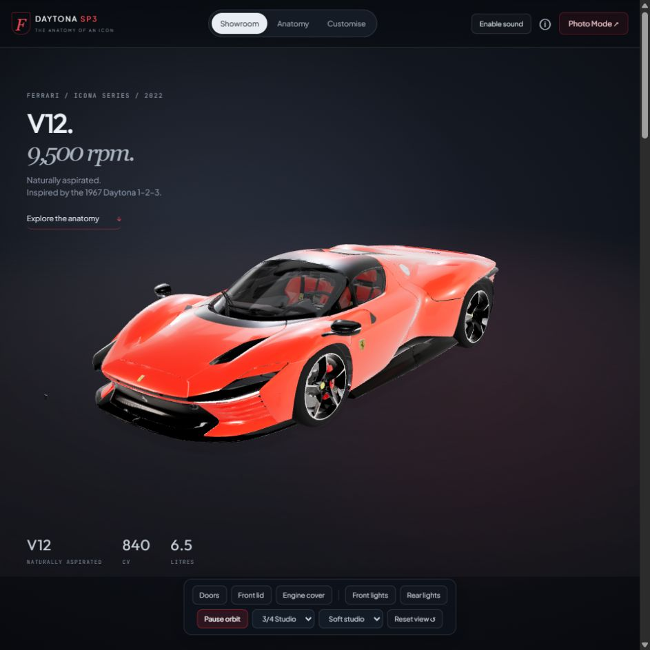
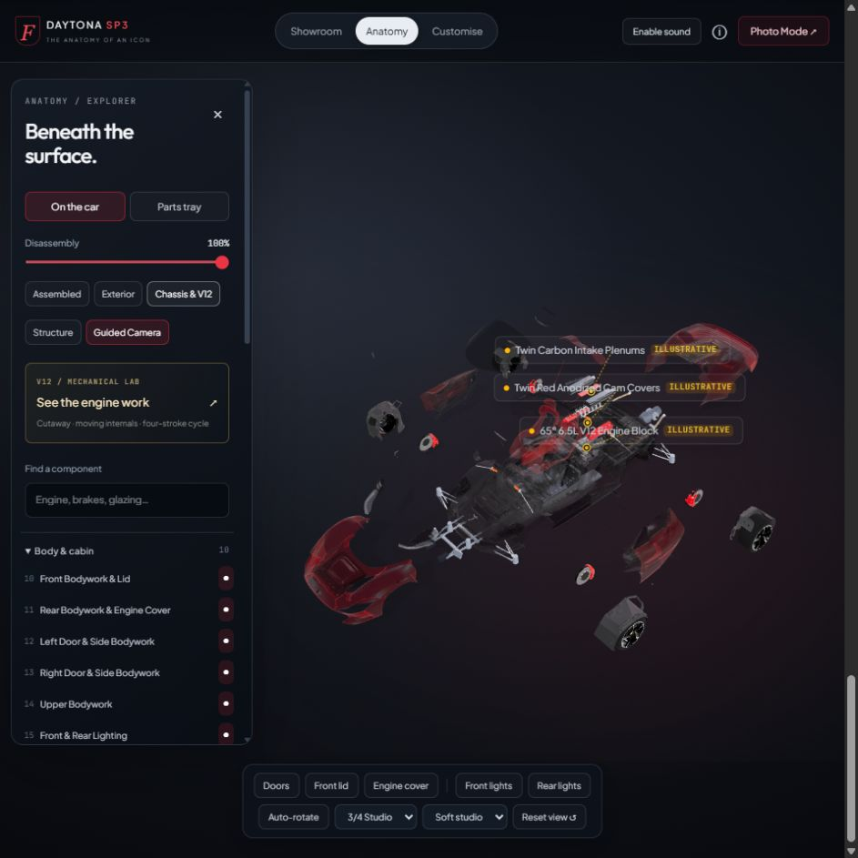
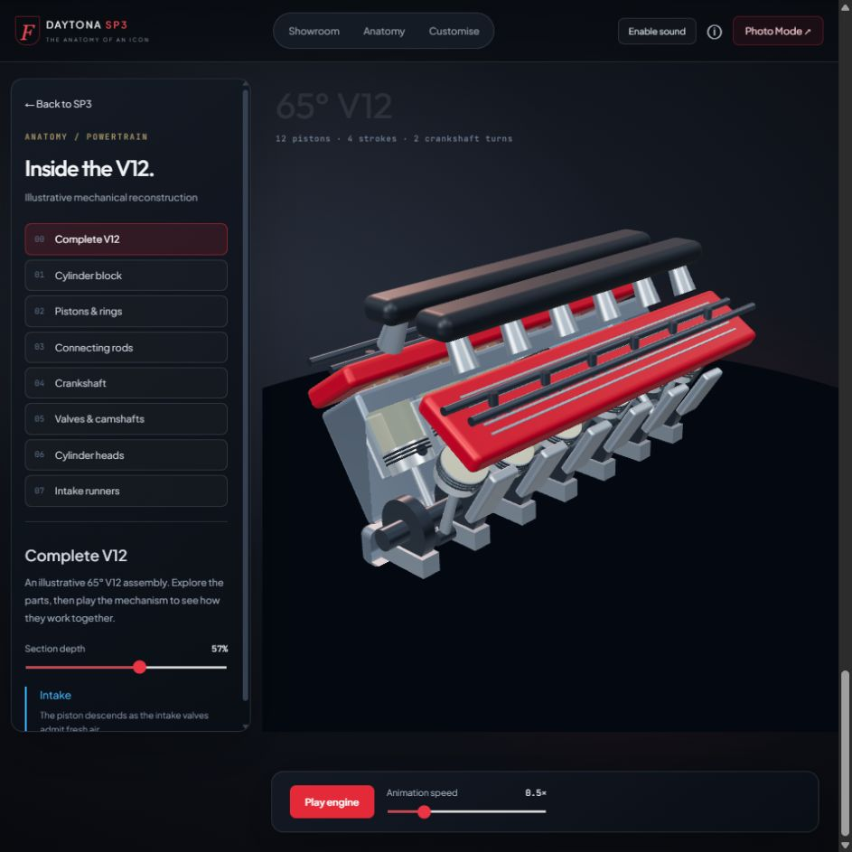

# Daytona SP3 — Interactive 3D Experience

[Live experience](https://maskedcm.github.io/daytona-sp3-experience/) · [Architecture](docs/ARCHITECTURE.md) · [Deployment & maintenance](docs/DEPLOYMENT.md) · [Asset credits](ASSET-LICENSES.md)

An interactive study of the Ferrari Daytona SP3: begin with the assembled car, scroll through its exterior assemblies, then explore an illustrative chassis and V12 layer. Change finishes, inspect individual components, open the butterfly doors, and listen to a continuous engine loop.



**Independent educational fan project by [MaskedCM](https://github.com/MaskedCM). Not affiliated with, sponsored by, or endorsed by Ferrari.** The mechanical reconstruction explains the layout and movement of a V12; it is not OEM CAD or a service manual.

## What you can explore

| Area | Included features |
| --- | --- |
| **Showroom** | Rotating car, drag-to-orbit camera, front/profile/rear/top presets, three lighting environments, front and rear lights. |
| **Openings** | Butterfly doors with inner cards and glazing moving together, front lid and rear engine cover, composed with the exploded view. |
| **Anatomy** | Scroll-driven disassembly, seven chapters, 19 model presentation groups plus 13 illustrative mechanical groups, component labels, search, hide/isolate and connected assemblies. |
| **Structure & parts tray** | Reveal the chassis and powertrain layer, adjust separation from 1× to 3×, or browse assemblies in a paged inspection tray. |
| **Customise** | Exterior palette and colour picker, caliper colours, leather finishes, hardtop finish, cockpit view and six wheel designs. |
| **V12 mechanical lab** | Twelve animated pistons and connecting rods, crankshaft, valve motion and the four-stroke cycle; playback and component selection. |
| **Photo Mode** | Compose with 35/50/85 mm lenses and export clean 4K landscape, square or portrait images without interface controls. |
| **Sound** | Explicit opt-in, startup once followed by a continuous running loop, original recorded revs repeating until Stop, smooth transitions, volume, mute, panel foley and cockpit/cover acoustics. |

The six wheel options are **Factory SP3, Split-Y, Ten-Spoke, Cross-Mesh, Five-Blade and Aero Disc**. The five alternatives are procedural visual concepts, not an official Ferrari options catalogue.

## More views

| Exploded anatomy | V12 mechanical lab |
| --- | --- |
|  |  |

## How to use it

1. Open the [live site](https://maskedcm.github.io/daytona-sp3-experience/) and allow the car and lighting assets to load.
2. Drag the scene to look around. Use **Doors**, **Front lid**, **Engine cover**, **Front lights** and **Rear lights** along the bottom.
3. Scroll, or choose **Anatomy**, to separate the car. Select a label or find a component in the hierarchy. **Chassis & V12** reveals the deeper illustrative layer.
4. Choose **Customise** for paint, wheels and finishes. **Step inside the cockpit** changes the camera to the cabin.
5. Open **V12 / Mechanical Lab** from Anatomy to inspect the animated engine mechanism.
6. Select **Enable sound** if you want audio. **Start engine** plays startup once, then keeps running. **Rev** repeats the original natural revs until **Stop**. Returning to Start from Rev crossfades to the running sound without replaying the starter.
7. Use **Photo Mode** to compose and save a clean image.

Sound starts only after an explicit click. Muting or hiding the browser tab stops playback; unmuting does not restart it. Reduced-motion preferences disable automatic rotation and guided camera movement initially. The wheel choice is remembered in browser local storage; there is no account or database.

## Run locally

Use **Node.js 24** and npm. The `.nvmrc` and `engines` field declare the build toolchain; `package-lock.json` locks the dependency graph.

```sh
git clone https://github.com/MaskedCM/daytona-sp3-experience.git
cd daytona-sp3-experience
npm ci
npm run dev
```

Open the local URL printed by Vite, normally `http://127.0.0.1:3000`.

**No Gemini API key, AI Studio subscription, server process or database is required to run the published experience.** AI Studio and Codex assisted development; they are not runtime services. The car, HDR lighting, audio, JavaScript and fonts are bundled with the site. External credit links open only when a visitor chooses to follow them.

## Build and verify

```sh
npm run typecheck
npm test
npm run build
npm run verify:dist
npm run preview
```

Or run `npm run check` for type checking, tests, production build and artifact verification in sequence. `preview` serves the production build locally; it is not the production host.

The regression suite covers 30 behaviours, including geometry framing, reversible explosion, actual GLB group structure, hinged door assemblies, all six wheel designs, engine mechanism constraints, finish targeting, tray restoration, label layout and audio lifecycle. Audio tests advance a controlled clock beyond 60 seconds to verify sustained loops and cancellation. They complement browser checks; they do not measure GPU performance or replace listening on real devices.

The production verifier checks the configured path prefix, entry assets, real GLB/HDR headers, attribution files, self-hosted fonts and deployment size. A GitHub Pages build uses the repository subpath, rather than assuming deployment at a domain root.

## Publishing and long-term availability

The site is built and hosted by **GitHub Actions + GitHub Pages**. A push to `main` runs checks, builds `dist/` and deploys only after a successful build. Pull requests run validation without publishing. A manual **Run workflow** is also available.

```text
Source on GitHub → locked install → type check + tests → build → verify artifact → GitHub Pages
```

The repository is the durable source; the deployment can be rebuilt from it. GitHub Pages serves static files, so the site does not depend on this laptop staying on, a preview tunnel remaining open, Gemini credits resetting, or a continuously running application server.

No provider can promise that a website will run forever. Availability depends on the GitHub account and repository remaining accessible, Pages staying enabled, the provider's terms and usage limits, and supported browsers with working WebGL. The initial model is about 14.8 MB and the HDR environment about 6.3 MB; large assets make first-load network quality and hosting bandwidth relevant.

Keep a local clone and a release archive. If hosting ever changes, rebuild and move `dist/` to another static host. See the [deployment guide](docs/DEPLOYMENT.md) for rollback, subpath builds and migration.

## Implementation map

```text
src/
  App.tsx                         Experience state and scroll coordination
  components/
    StudioCanvas.tsx              Three.js car scene and rendering lifecycle
    ExperienceControls.tsx        Showroom, Anatomy and Customise controls
    EngineLab.tsx                 Animated V12 inspection scene
    ReferenceModal.tsx            Model, environment and sound attribution
  utils/
    explosionGroups.ts            Presentation groups, sequence and labels
    lightsAndOpenings.ts          Door/lid hinge transforms and light bindings
    illustrativeMechanicalLayer.ts  Educational chassis and engine geometry
    engineMechanism.ts            Slider-crank and four-stroke animation
    wheelDesigns.ts               Factory and procedural wheel options
    experienceScene.ts            Finishes, tray, camera fit and image export
    publicAssets.ts               Domain-root and GitHub Pages asset resolution
  audio/
    soundEngine.ts                Opt-in Web Audio controller and cleanup
    freeSoundPack.ts              Embedded clips and source metadata
public/
  models/                         Meshopt-compressed SP3 GLB
  environments/                   Studio HDRI
  assets/                         Technical reference image
.github/workflows/pages.yml       Validation and production deployment
```

The sound pack filename is a development-era name. **It does not mean every embedded clip has a verified free-use licence.** Read the credits below before reusing media.

## Credits, licensing and accuracy

- **Car model:** “Ferrari Daytona SP3 2022 | www.vecarz.com” by **vecarz**, sourced from Sketchfab under the recorded **CC BY 4.0** licence. Regrouped into presentation assemblies, compressed with Meshopt and quantized for web delivery. Attribution and modification details remain in the app and [model credits](public/MODEL-CREDITS.md).
- **Lighting:** “Studio Small 09” from **Poly Haven**, CC0.
- **Engine audio:** user-selected excerpts from **DARK WORKS**, *PURE V12 SOUND | Ferrari Daytona SP3 (Assetto Corsa EVO 0.4)*. These are game sounds, not a real-car microphone recording. **Reuse licence has not been verified; attribution is not a grant of permission.**
- **Panel foley:** **kennydoug**, *CAR DOOR OPEN CLOSE.wav*, CC0. This is generic car-door foley, not an SP3-specific recording.
- **Fonts:** Outfit, Plus Jakarta Sans and JetBrains Mono, self-hosted through Fontsource; their individual OFL licence notices are included under `docs/third-party/`.
- **Reference sheet:** Ferrari product-information imagery assembled for technical reference. It is not covered by the model's CC BY licence or by a project-wide media licence.

The chassis, V12 internals, connections and disassembly sequence are illustrative reconstructions. Dimensions, hinge clearances and labels are presentation choices and should not be used for repair, manufacturing or engineering decisions. Ferrari trademarks, emblems and vehicle designs belong to their respective owners.

This is a **public source repository**, not a blanket licence for the code and all media. No project-wide open-source licence has been granted. Third-party assets retain their own licences and restrictions. See [ASSET-LICENSES.md](ASSET-LICENSES.md) for source links, changes and reuse notes.

## Further reading

- [Architecture and design decisions](docs/ARCHITECTURE.md)
- [Deployment, rollback and maintenance](docs/DEPLOYMENT.md)
- [Project development story](docs/PROJECT-STORY.md)
- [Asset sources and licences](ASSET-LICENSES.md)
- [Vite static deployment](https://vite.dev/guide/static-deploy)
- [GitHub Pages limits](https://docs.github.com/en/pages/getting-started-with-github-pages/github-pages-limits)
